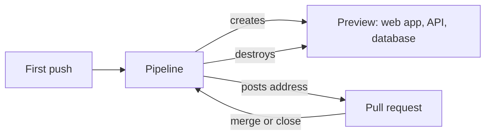

# Give each pull request its own short-lived preview environment

Status: In review
Author: Nia
Decider: Sol, director of engineering
Decision needed by: February 12, 2027

## Decision

We recommend one preview environment for each pull request, created by the pipeline in the existing cluster. Reviewers then stop queueing for the one shared staging environment. The main cost is $2,900 a month from the platform budget.

## Problem and goals

One staging environment serves 11 teams. A team reserves it in a chat channel, deploys a branch, and releases it when the review ends. In January 2027 the median wait from "ready for review" to "reviewer tried it" was 26 hours, measured across 318 pull requests [1]. Staging was reserved for 71% of working hours [2].

The design must:

1. Bring the median wait from "ready for review" to "reviewer tried it" under 4 hours by June 30, 2027.
2. Let no pull request wait for staging.

Priorities, when goals conflict:

1. A reviewer never waits for another team. We pay for compute before we pay in waiting.
2. A preview is disposable. Nothing in it is worth keeping after the merge.
3. We care about quality.

### Out of scope

- Previews for the mobile apps, because their builds do not run in the cluster.

## Options

| Option | Wait for a reviewer | Cost | Verdict |
|---|---|---|---|
| A. One preview per pull request, in the cluster | 12 minutes after a push [3] | $2,900 a month [3] | Recommended |
| B. A second shared staging environment | Halves the queue at best | $1,100 a month [4] | Rejected |
| C. The stack on each reviewer's laptop | 25 minutes to start [3] | No added cost | Rejected |

**A. One preview per pull request.** The pipeline already deploys to the cluster, so a preview is one more deployment of the same templates. Nobody reserves anything, which priority 1 asks for.

**B. A second shared staging environment.** It is the cheapest change, at $1,100 a month [4]. It halves the queue at best and keeps the reservation step, which priority 1 rules out.

**C. Docker Compose on each laptop.** It needs no cluster capacity. It takes 25 minutes to start [3], and the 9 reviewers in product and design have no development setup.

## Proposed design

### The life of a preview

The pipeline owns the whole life of a preview: it creates the environment, posts its address, and destroys it.

An environment holds the web app, the API, and a database. The pipeline creates it on the first push and posts its address on the pull request. It is destroyed when the pull request merges or closes. Previews and pipelines share cluster memory.

Preview environments cut most of the wait, because nobody queues for staging. Compared with today's 31-hour wait, a reviewer opens the preview as soon as the pipeline finishes, which takes 12 minutes.

### At most 40 environments at once

We run at most 40 environments at once, because that keeps preview use under 30% of cluster memory. When the limit is reached, the oldest idle preview is removed. The 30% figure comes from a one-week trial with 6 environments. At the January rate of pull requests the limit is reached on 2 days a month. Without a limit, a cluster out of memory would make pipelines queue for every team.

### Seed data

Each preview database loads the seed data set, because it holds no customer data. A reviewer therefore cannot try a change against real data. A copy of production data would put customer data where anyone with the preview address can read it.

## Cost

Previews cost $2,900 a month from the platform budget [3]. The monthly cost is in the 2027 plan as a line item pending this decision.

## Failure modes and risks

What can go wrong in the cluster:

| Trigger | Effect | Response |
|---|---|---|
| The cluster runs out of memory | Pipelines queue | The limit of 40 environments holds preview use under 30% of memory |

Database seeding could be problematic.

## Outcomes

| Outcome | Measure | Today | Target |
|---|---|---|---|
| Reviewers stop waiting for staging | Median wait from "ready for review" to "reviewer tried it" | 26 hours [1] | Under 4 hours |
| A preview is ready soon after a push | Time from push to an open preview | No previews | 12 minutes |

## Open questions

None.

## Sources

1. Pull request timestamps, January 2027, 318 pull requests
2. Staging reservations in the team chat channel, January 2027
3. One-week preview trial with 6 environments, December 2026
4. Cluster cost estimate from the platform team, January 2027

## FAQ

### Why not make staging faster to reserve?

The wait is the queue, not the reservation. Staging was reserved for 71% of working hours in January 2027.

### Who pays for it?

The platform budget.
